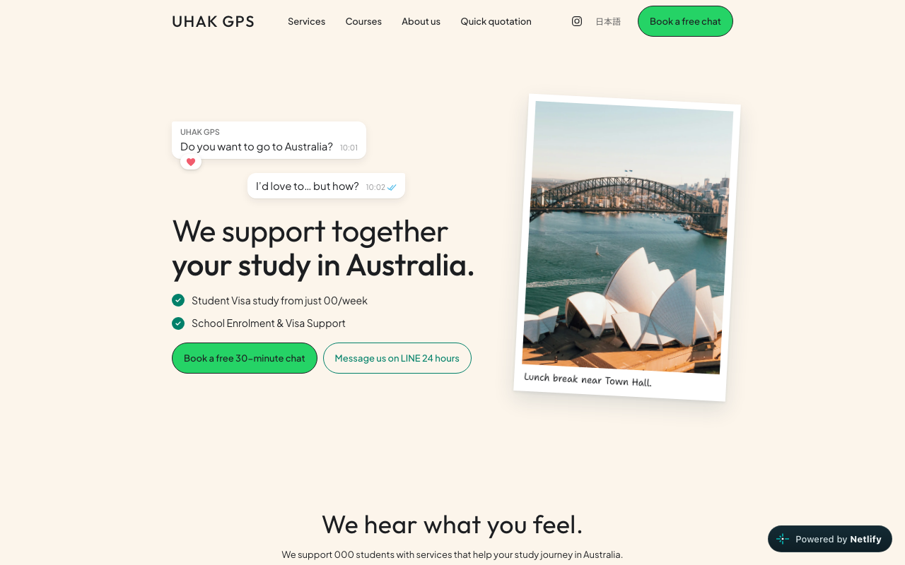
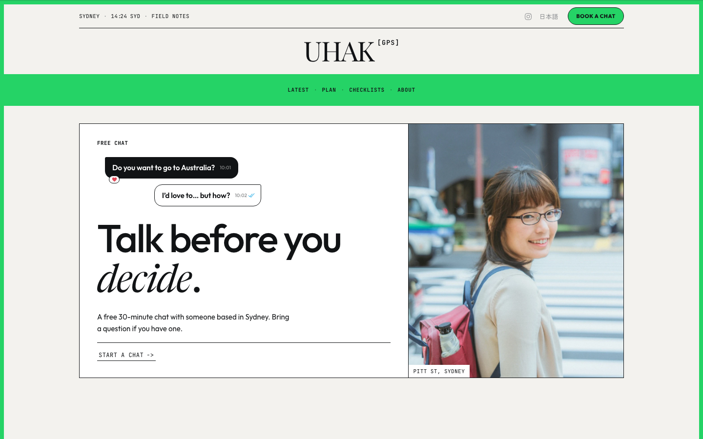
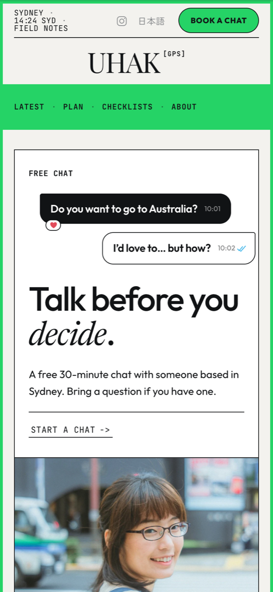
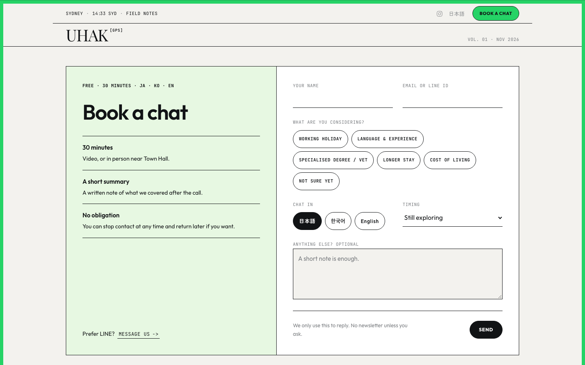

# UHAK GPS

Astro + React landing site for **UHAK GPS** — Sydney-based study abroad & Working Holiday guidance.

**Live**

- English: [https://uhak-gps.netlify.app/](https://uhak-gps.netlify.app/)
- Japanese: [https://uhak-gps.netlify.app/ja/](https://uhak-gps.netlify.app/ja/)

[](https://uhak-gps.netlify.app/)

## Features

- Static landing with interactive React sections (options picker, how-it-works steps, flip ID card)
- **EN / JA** i18n — `/` and `/ja/`, soft client-side language switch (fade + `history.pushState`, no full reload)
- Sticky floating header on scroll, square nav underline, WhatsApp-style hero chat animation
- Responsive layout (breakpoint `760px`)
- Netlify deploy from `main` + GitHub Actions CI (`npm ci` + `npm run build`)

## `/zine/` — editorial redesign (work in progress)

> **Status:** an experimental magazine-style edition of the site, being redesigned as a **separate portfolio piece**.
> It ships with the build at `/zine/` but is **`noindex`**, not linked from the landing, and **not the live site**.
> Its copy has **not yet been unified with the main landing** — treat `/` and `/ja/` as the source of truth until it is.

| Home (desktop) | Home (mobile) |
| --- | --- |
| [](https://uhak-gps.netlify.app/zine/) |  |

[](https://uhak-gps.netlify.app/zine/book/)

**Routes:** `/zine/` (home) · `/zine/guides/` (single feature-article skeleton) · `/zine/book/` (booking form → Netlify Forms)

**Where it lives** — fully separate from the landing; no shared components or CSS:

```
src/pages/zine/            → index, guides/index, book
src/layouts/ZineLayout.astro
src/components/zine/       → Masthead, Wordmark, EdChat, SpotArt, Footer, InstagramLink
src/zine/content.ts        → all zine copy (English only, separate from src/i18n/)
src/scripts/zine-motion.ts → sticky section bar, reveals, smooth scroll
src/styles/zine.css        → Editorial Green tokens (bundled only on /zine/ pages)
public/images/spot/        → spot illustrations
docs/design-zine.md        → zine design guidelines
```

**Before the zine can replace or sit beside the landing, its content needs syncing with main:**

- [x] **Longer stay / residency wording** — unified on the zine's position: no visa/residency guarantees, registered-agent referral. Landing card renamed *Long-term Settlement → Longer Stay*.
- [ ] **Team** — zine lists three people (counsellor, Japanese desk, arrival support); landing shows one counsellor. *Intentionally left as is for now.*
- [x] **QEAC** — zine counsellor now shows *QEAC-qualified* (principles stay 3 on landing / 4 on zine).
- [x] **Service names** — zine plan cards and booking chips use the landing names (*Working Holiday · Language & Experience · Specialised Degree / VET · Longer Stay*).
- [x] **Booking** — `/zine/book/` submits to **Netlify Forms** (form `book-chat`, honeypot spam filter). Submissions: Netlify → Forms; email alerts: Forms → Form notifications.
- [x] **Landing booking** — every landing *Book* CTA goes to `/book/` or `/ja/book/` (landing design, same `book-chat` form; *Your Plan* picks prefill via `?plan=`).
- [ ] **LINE** — zine and landing LINE links are still `#line` (waiting on the official account URL).
- [ ] **Japanese** — zine is English-only; its 日本語 link jumps to the landing `/ja/`. *Left as is for now.*
- [x] **Shared facts** — `OFFICE` / `MAPS_URL` live in one module, `src/data/office.ts`, used by both surfaces.

## Stack

| Layer | Choice |
| --- | --- |
| Framework | Astro 7 (static) + `@astrojs/react` |
| UI | React islands (`client:only`) |
| CSS | Tailwind CSS v4 (`@tailwindcss/vite`) + lean `landing.css` |
| Hosting | Netlify (`netlify.toml`, publish `dist`) |
| CI | GitHub Actions (`.github/workflows/ci.yml`) |

## Site structure

```
src/
  pages/
    index.astro          → /     (en)
    ja/index.astro       → /ja/  (ja)
  layouts/BaseLayout.astro
  i18n/                  → en.ts / ja.ts / types / getMessages()
  components/landing/
    Landing.tsx          → locale state, soft language switch
    data.ts              → non-copy structure (icons, note meta, maps URL)
    ui.tsx               → Container, SectionTitle, KeepLines, buttons
    sections/            → Header, Hero, FeelNotes, Options, WhyUs,
                           HowItWorks, Schools, Airmail, About,
                           Principles, Footer (+ StickyBar unused)
  styles/
    global.css           → @theme tokens + fonts
    landing.css          → motion, header float, JA font remap
docs/design.md           → full design guidelines (landing)
docs/design-zine.md      → zine design guidelines (/zine/ only, see above)
public/images/           → polaroids, steps, map, etc.
legacy/                  → original single-file export
```

### Page sections (top → bottom)

1. Header (nav + language switch + Book CTA)
2. Hero (chat bubbles, headline, checks, polaroid)
3. Feel notes (sticky notes)
4. Options + Your Plan
5. Why us
6. How it usually goes (6 steps)
7. Schools
8. Airmail ticker
9. About + counsellor ID card
10. Principles
11. Footer

## Design

Full tokens and rules: **[docs/design.md](docs/design.md)** (UHAK GPS Green) — landing `/` and `/ja/` only.
The zine has its own system in **[docs/design-zine.md](docs/design-zine.md)**; don't mix tokens across the two.

**Summary**

| Token | Role |
| --- | --- |
| primary `#25D366` | Actions, nav underline, highlights |
| accent `#008069` | Secondary buttons, labels, icons |
| cream / mint / surface | Band backgrounds |
| ink `#1C1E21` | Body text |

- Content max width **864px**; one idea per section
- EN display: **Outfit** · body: **Plus Jakarta Sans**
- JA display/body: **Murecho → Zen Kaku Gothic New → Noto Sans JP**
- Handwriting accents: Shantell Sans / Klee One
- Prefer Tailwind tokens: `bg-cream`, `text-accent`, `font-display`, `rounded-pill`, `landing:…`

## Internationalization

- Astro `i18n`: default `en`, locales `en` | `ja`, `prefixDefaultLocale: false`
- Copy lives in `src/i18n/en.ts` and `src/i18n/ja.ts` (shared `Messages` type)
- Structure (tilts, icons, colors) stays in `src/components/landing/data.ts`
- Header switch updates locale in React, fades content, syncs `lang` / title / URL
- Korean (`ko`) can be added later the same way

## Local development

```bash
npm install
npm run dev
```

```bash
npm run build
npm run preview
```

Dev server tip (from `AGENTS.md`): `astro dev --background`, then `astro dev status` / `logs` / `stop`.

## Deploy

- Push to `main` → Netlify build (`npm run build` → `dist`)
- GitHub Actions CI runs the same build check on push/PR

## Next steps

Tracked in GitHub Issues — remaining highlights:

- Wire `#line` CTAs (booking is live at `/book/`)
- Placeholder numbers (`00/week`, `000 students`)
- StickyBar restore or remove
- Nav IA cleanup
- Open Graph / social preview
- Analytics, search, Sveltia CMS + blog
- Unify `/zine/` copy with the landing (checklist under [`/zine/`](#zine--editorial-redesign-work-in-progress))
